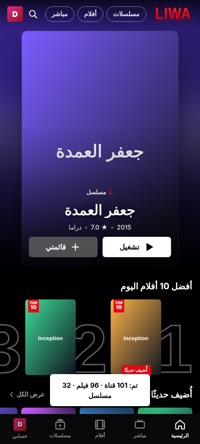
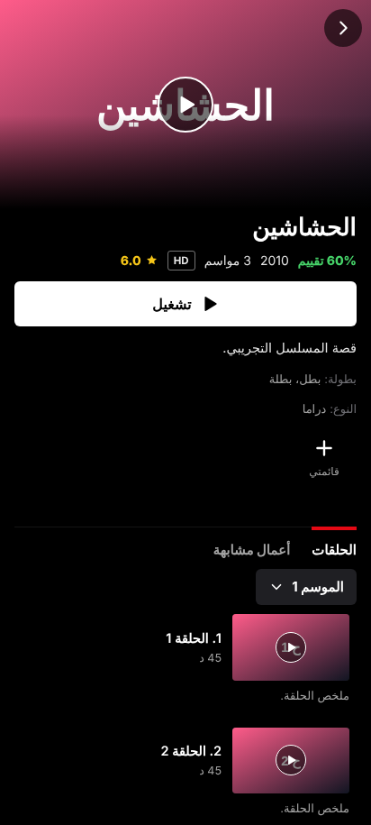
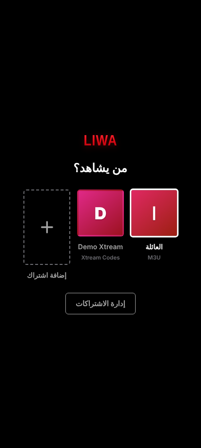
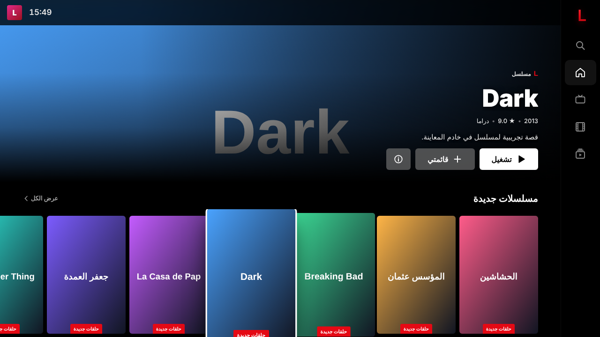
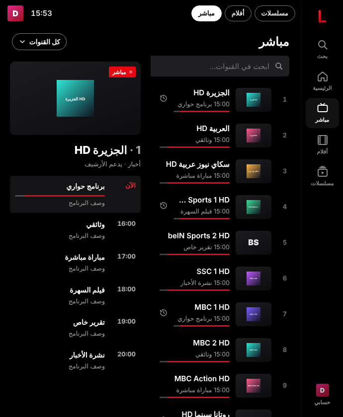
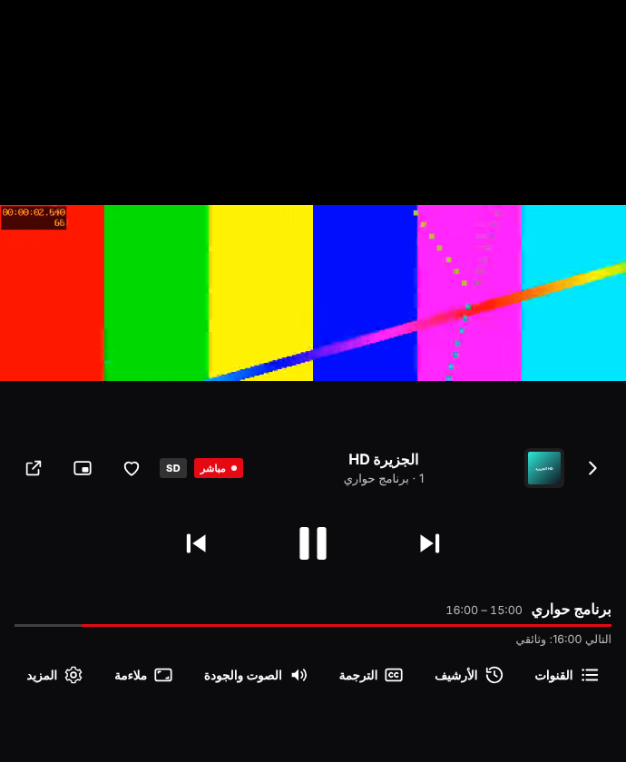

# LiwaIPTV — مشغّل اشتراكات IPTV لأندرويد وأندرويد TV

<p align="center">  </p>
<p align="center"></p>
<p align="center"> </p>

تطبيق يشغّل اشتراكات IPTV على اختلاف أنواعها، فيعرض شعارات القنوات وأغلفة
الأفلام والمسلسلات مصنّفةً حسب أقسام مزوّدك، مع مشغّل فيديو متقدم يدعم الترجمة.
تتكيف الواجهة مع الهاتف والتابلت والتلفاز (الريموت مدعوم).

> المشغّل لا يوفّر أي محتوى أو اشتراكات؛ أنت من يضيف اشتراكه.
> الصور أعلاه من خادم المعاينة التجريبي المرفق (بيانات وهمية).

## ⬇️ التحميل

**[تحميل LiwaIPTV.apk](../download/LiwaIPTV.apk)** (‎~3 ميجابايت، أندرويد 5.1 فأحدث).
ثبّته ثم اسمح بالتثبيت من مصدر غير معروف حين يطلب الجهاز ذلك.

## التصميم (1.1)

واجهة بروح نتفليكس بالعربية:
- خلفية سوداء ولون أحمر LIWA، وشاشة بداية متحركة، وشاشة «من يشاهد؟» لكل اشتراك ملفه الخاص.
- لوحة عرض كبيرة في الرئيسية، ثم صفوف أفقية: متابعة المشاهدة، أفضل 10 بأرقام كبيرة، قائمتي،
  «لأنك شاهدت…»، والأقسام الأكثر محتوى. شارات «أُضيف حديثًا» و«TOP 10».
- صفحة تفاصيل بزر تشغيل أبيض، ونسبة التقييم، وقائمة الحلقات مع اختيار الموسم، وتبويب «أعمال مشابهة».
- **التلفاز**: شريط جانبي يتّسع عند التركيز، واللوحة الكبيرة ثابتة أعلى الشاشة وتعرض العنصر الذي يقف عليه الريموت،
  والمباشر بثلاثة أعمدة (الفئات، القنوات، جدول برامج القناة المحددة).
- **الهواتف القابلة للطي**:
  - شاشة الغلاف المغلقة: تخطيط مضغوط.
  - الشاشة الداخلية المفتوحة: شريط تنقل جانبي، ولوحة عريضة، وصفحة تفاصيل بعمودين.
  - **وضع الكتاب** (نصف مفتوح، المفصّل عمودي): المعلومات في نصف والحلقات في الآخر، أو القنوات في نصف وجدول البرامج في الآخر.
  - **وضع الطاولة** (المفصّل أفقي): الفيديو في النصف العلوي وأزرار التحكم في السفلي.

  يُقرأ موضع المفصّل من Jetpack WindowManager، ويُدعم أيضًا Viewport Segments في المتصفحات التي تدعمه.

## المميزات

**أنواع الاشتراكات**
- **Xtream Codes**: رابط الخادم مع اسم المستخدم وكلمة المرور، وهو أغنى الأنواع: أقسام وأغلفة وقصص ودليل برامج وأرشيف.
- **M3U / M3U8**: برابط أو بملف من الجهاز. رابط `get.php` يُحوَّل تلقائيًا إلى Xtream ليحصل على مزاياه كلها.
  يقرأ `tvg-logo` و`group-title` و`tvg-id` و`catchup-days` وترويسات `EXTVLCOPT`/`KODIPROP` وصيغة `رابط|User-Agent=…`.
- **بوابات MAC (Stalker/Ministra)**: رابط البوابة وعنوان MAC، وتعمل فيها القنوات والأفلام والمسلسلات.
- اشتراكات متعددة تظهر كملفات شخصية في شاشة «من يشاهد؟»، ولكل اشتراك قائمته وسجلّه.

**التصنيف والعرض**
- خمسة أقسام: الرئيسية، مباشر، أفلام، مسلسلات، بحث، ومعها أقسام المزوّد مع عدد العناصر في كل قسم.
- في قوائم M3U يُميَّز المحتوى تلقائيًا إلى قناة أو فيلم أو حلقة، من مسار الرابط وامتداده ومن الاسم
  (`S02E05` و`1x04` و«الموسم 3 الحلقة 12»)، ثم تُجمع الحلقات في مسلسلات ومواسم.
- تنظيف أسماء الأفلام: حذف البادئات مثل `AR |` و`[4K]` واستخراج السنة والجودة.
- فرز حسب الأحدث إضافةً أو الاسم أو التقييم أو سنة الإصدار أو رقم القناة.
- بحث عربي يتجاهل الهمزات والتشكيل والتاء المربوطة: «الجزيره» يجد «الجزيرة».
- المفضلة، و«شوهد مؤخرًا»، و«متابعة المشاهدة» من الموضع الذي توقفت عنده، وتقدّم كل حلقة.
- دليل البرامج (EPG): البرنامج الحالي مع شريط تقدمه بجانب كل قناة، وفي المشغّل الحالي والتالي.
  مصدره خادم Xtream أو Stalker، أو ملف XMLTV لقوائم M3U.
- **TMDB (اختياري)**: يكمل الأغلفة والقصص والممثلين والإعلان الناقصة، وهو مفيد لقوائم M3U.

**المشغّل**
- يختار المحرك تلقائيًا (HLS أو MPEG-TS أو المشغل الأصلي)، وينتقل إلى غيره إن فشل،
  ويعيد الاتصال بصمت عند انقطاع البث المباشر.
- تقليب القنوات بالسحب أو بالأسهم أو بأزرار القنوات، أو بكتابة رقم القناة بالريموت، مع قائمة قنوات جانبية فيها بحث.
- **الأرشيف (Catch-up)** للقنوات التي تدعمه.
- قائمة الحلقات داخل المشغّل، وتشغيل الحلقة التالية تلقائيًا بعد عدّ تنازلي.
- **الترجمة**: المضمّنة في الفيديو، أو ملف SRT/VTT/ASS من الجهاز (مع دعم الترميز العربي القديم Windows-1256)،
  أو بحث وتنزيل من **OpenSubtitles**. يمكن تقديمها أو تأخيرها بخطوات نصف ثانية، وتغيير حجمها ولونها وخلفيتها وموضعها.
- اختيار المسار الصوتي والجودة، وعرض الدقة ومعدّل البث.
- أوضاع العرض: ملاءمة، ملء، تمديد، 16:9، 4:3، تكبير. سرعة التشغيل من 0.5× إلى 2×.
- إيماءات اللمس: لمستان للتقديم أو الرجوع 10 ثوانٍ، وسحب عمودي للصوت (يمين الشاشة) والسطوع (يسارها)، وسحب أفقي للتنقل في الفيديو.
- صورة داخل صورة، وتعمل تلقائيًا عند الخروج من التطبيق أثناء التشغيل. وأيضًا مؤقت للنوم، وقفل للشاشة من اللمس، وتدوير أفقي تلقائي.
- **مشغّل خارجي** (VLC أو MX Player) بضغطة واحدة، لصيغ لا يدعمها المشغل الداخلي.

**الرقابة الأبوية**: أقسام الكبار مخفية تلقائيًا، ويمكن قفل أي قسم برمز سري بضغطة مطوّلة عليه.

## حدود يجب معرفتها

- المشغّل الداخلي يعتمد على محرك فيديو أندرويد (WebView)، وهو يشغّل H.264/H.265 مع AAC/MP3 بلا مشاكل.
  أما الصوت بصيغة **AC3 أو E-AC3 أو DTS** (شائعة في ملفات MKV) فقد يغيب. يكشف التطبيق ذلك وينصحك بالمشغل الخارجي،
  ويمكنك جعل المشغل الخارجي هو الافتراضي من الإعدادات.
- تبديل المسار الصوتي متاح لبث HLS. أما ملفات MKV متعددة المسارات فتحتاج المشغل الخارجي.
- جُرّب التطبيق على خادم Xtream تجريبي وقوائم M3U في متصفح Chromium، وبُني الـ APK ووُقّع بنجاح.
  جُرّبت أيضًا مقاسات شاشة الغلاف والشاشة المفتوحة والتلفاز، ووضعيتا الكتاب والطاولة بمحاكاة موضع المفصّل في المتصفح.
  لم يُجرَّب بعد على جهاز أندرويد حقيقي (هاتف قابل للطي أو تلفاز) ولا مع مزوّدين حقيقيين. وبوابات Stalker تختلف كثيرًا من مزوّد لآخر،
  فدعمها **تجريبي**.

## كيف يعمل (للمطوّرين)

```
iptv/
  www/                 الواجهة (HTML/CSS/JS بلا خطوة بناء)
    js/xtream.js       عميل Xtream Codes API
    js/m3u.js          محلل M3U والتصنيف وتجميع الحلقات
    js/stalker.js      بوابات MAC
    js/epg.js          دليل XMLTV
    js/subs.js         SRT/VTT/ASS وOpenSubtitles
    js/engine.js       اختيار hls.js / mpegts.js / المشغل الأصلي
    js/player.js       شاشة التشغيل
    js/library.js      المكتبة والفرز والمفضلة والسجل
    js/app.js          الشاشات والإعدادات
    vendor/            hls.js 1.6.13 و mpegts.js 1.8.0
  scripts/
    patch-android.mjs  يولّد الكود الأصلي (الوسيط وإضافة LiwaNative) ويهيئ المانيفست
    make-icons.py      الأيقونات ولافتة أندرويد TV
    selftest.mjs       اختبار المنطق (78 فحصًا)
    mock-server.mjs    خادم Xtream تجريبي للمعاينة
```

- **طلبات الواجهات** (Xtream وM3U وEPG) تمر عبر `CapacitorHttp`، أي عبر طبقة أندرويد الأصلية، فلا تعيقها قيود CORS.
- **البث** يمر عبر `LiwaWebViewClient`، وهو وسيط داخل التطبيق يضيف ترويسات CORS و User-Agent/Referer لكل مضيف.
  يتبع التحويلات بين http و https، ويحوّل روابط قوائم m3u8 النسبية إلى روابط كاملة بعد التحويل.
- التخزين في IndexedDB، ويتسع لقوائم بعشرات آلاف العناصر. وتُعرض القوائم الطويلة على دفعات حتى لا تتجمد الواجهة.

### التشغيل محليًا

```bash
cd iptv
npm install
node scripts/selftest.mjs                 # اختبار المنطق
node scripts/mock-server.mjs 8787         # معاينة: http://localhost:8787 (demo / demo)
```

### بناء APK

يُبنى تلقائيًا من GitHub Actions عند دفع وسم يبدأ بـ `iptv-v` (مثال `iptv-v1.0.0`)، أو يدويًا من تبويب Actions.
محليًا (Node 22 و JDK 17+ و Android SDK 34):

```bash
cd iptv
npx cap add android && npx cap sync android
node scripts/patch-android.mjs android
python3 scripts/make-icons.py android/app/src/main/res
cd android && ./gradlew assembleRelease
```

التوقيع يستخدم `signing/liwaiptv.jks` (كلمة المرور `liwaiptv`). ولإصدار رسمي ضع مفتاحك في أسرار المستودع:
`IPTV_KEYSTORE_B64` و`IPTV_KEYSTORE_PASSWORD` و`IPTV_KEY_ALIAS`.
